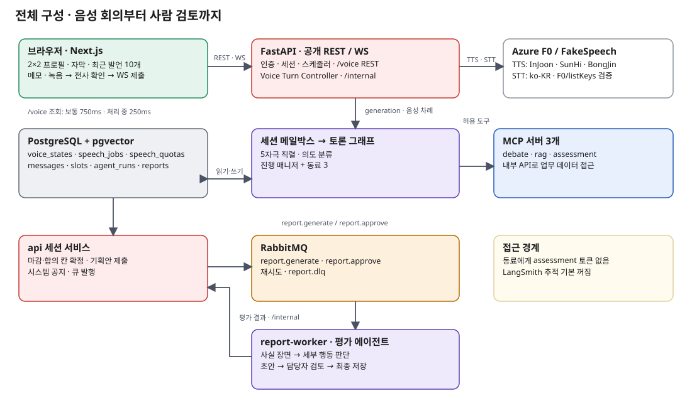

# Day Zero

AI 동료 3명과 음성으로 토론하는 모습에서 협업 태도를 보는 채용 평가 서비스 MVP
*A hiring assessment MVP: candidates debate with three AI teammates by voice, and recruiters review evidence-based reports.*

SK AX SKALA 팀 프로젝트(6명) · 2026.10 · [결과 보고서](docs/share/report.pdf) · [제품 가이드](docs/share/product-guide/index.html)

Day Zero는 지원자가 AI 동료 3명과 턴 기반 음성으로 토론하는 과정에서 드러나는 행동으로 인성(토론 태도)을 보고, 기업의 인사담당자가 그 행동 근거로 면접·채용 판단을 하도록 돕는 채용 서비스의 MVP다.

지원자는 초대 링크로 들어와 안내에 동의한 뒤, AI 동료 3명(고집형·소극형·비판형)과 한 토론방에서 키워드 → 문제 상황 → 해결책을 차례로 합의하고 마지막에 기획안을 써서 제출한다. 세션은 60분(데모 15분)이고, 단계마다 남은 시간이 보이며, 키워드가 정해지면 그 키워드의 참고 자료와 AI 어시스턴트를 쓸 수 있다.

담당자는 채용 건을 만들고 지원자를 초대한다. 세션이 끝나면 평가 에이전트가 공개된 행동 기준 척도로 지원자 행동 근거를 들어 요소별 수준을 판단한 리포트 초안을 만들고, 담당자가 근거 원문과 전체 기록을 보며 차원 단위로 조정한 뒤 검토를 완료한다. 평가는 토론 태도(설득/논리력·경청/존중·배려/포용·수용/유연성·정직/공정)만 보고 실력은 넣지 않는다. 리포트는 담당자가 평가할 때 보는 참고 자료다. 기획 정본은 [PRD.md](PRD.md).

## 구성

| 서비스 | 역할 | 문서 |
|---|---|---|
| web | 지원자 토론방·기획안·디브리핑과 담당자 관리자 화면(Next.js) | [apps/web/README.md](apps/web/README.md) |
| api | 인증·REST·WebSocket·세션 시계, 토론 그래프(진행 매니저 + 페르소나 3)·어시스턴트·의도 분류. DB 쓰기는 api만 한다 | [services/api/README.md](services/api/README.md) |
| debate-mcp | 토론 상태를 읽고 쓰는 MCP 도구(메시지 게시·안 제안·입장·합의 칸 채우기) | [services/debate-mcp/README.md](services/debate-mcp/README.md) |
| rag-mcp | 확정된 키워드의 참고 자료 검색·조회(BGE-M3, pgvector) | [services/rag-mcp/README.md](services/rag-mcp/README.md) |
| assessment-mcp | 평가용 세션 기록 조회와 관찰·평가 저장. 페르소나는 접근하지 못한다 | [services/assessment-mcp/README.md](services/assessment-mcp/README.md) |
| report-worker | 세션 종료 후 큐 작업으로 평가 에이전트를 돌려 리포트 초안을 만들고 검토 완료 뒤 확정한다 | [services/report-worker/README.md](services/report-worker/README.md) |
| postgres | PostgreSQL 16 + pgvector | [docs/architecture/data-model.md](docs/architecture/data-model.md) |
| rabbitmq | 리포트 생성 큐(재시도·DLQ) | [docs/contracts/queue.md](docs/contracts/queue.md) |



전체 구조와 원칙은 [docs/architecture/overview.md](docs/architecture/overview.md).

## 빠른 실행

필요한 도구는 Python 3.12(`uv`), Node 22(`pnpm`), Docker Compose v2다. 로컬 개발 모드의 전체 순서는 [docs/guides/quickstart.md](docs/guides/quickstart.md).

```
cp infra/.env.example infra/.env   # 비밀값을 채운다. LLM 없이 돌리려면 LLM_FAKE=1
make up SCOPE=infra                # postgres·rabbitmq·rag-mcp(프로필 dev-fake)
# api·MCP 2개·report-worker·web을 로컬에서 띄운다(quickstart.md 4)
make seed SCOPE=infra              # 자료 원문 → 관리자·채용 건 → rag 재색인
make stage STAGE=keyword MIN=15    # 단계 시드 세션의 초대 링크 출력
```

지금 실제 LLM으로 돌고 있는지(`[fake]` 표시가 없어도 고정 응답일 수 있다)는 [quickstart.md](docs/guides/quickstart.md) "7. 실제 LLM으로 돌고 있는지 확인하기"로 확인한다.

8개 서비스를 모두 컨테이너로 띄우려면 `make up PROFILE=dev-fake`(가짜 LLM, 외부 호출 없음). 이 모드의 시드는 `make seed PROFILE=dev-fake`(compose 안의 일회성 seed 서비스, 포트를 열지 않음). 실행 프로필과 과금 동의(`ALLOW_API=1`)는 [docs/guides/configuration.md](docs/guides/configuration.md).

## 폴더

| 폴더 | 내용 |
|---|---|
| `apps/` | web(Next.js) |
| `services/` | api, MCP 서버 3개, report-worker(Python, 서비스마다 `uv` 프로젝트) |
| `scenarios/` | 미션 카탈로그(페르소나·카드·척도·프롬프트·자료)와 e2e 대본·단계 시드 |
| `infra/` | compose 파일, DB 스키마, `.env.example` |
| `scripts/` | 시드·세션 조립·시간 당기기·문서 생성 스크립트 |
| `tests/` | 계약 픽스처, e2e 러너, eval 픽스처, playtest |
| `docs/` | 설계 문서. `docs/share/`는 공유용 산출물 |
| `build/` | `PRD.md` → `PRD.html` 빌드 |

## 문서

색인은 [docs/README.md](docs/README.md). 자주 찾는 문서:

| 목적 | 문서 |
|---|---|
| 제품 가이드(공유용, 정본 아님) | [docs/share/product-guide/index.html](docs/share/product-guide/index.html) |
| 기능·구현 상태·검증 테스트 | [docs/features.md](docs/features.md) |
| 단계·페르소나·카드·합의 규칙 | [docs/product/scenario.md](docs/product/scenario.md) |
| 평가 척도와 판단 규칙 | [docs/product/rubric.md](docs/product/rubric.md) |
| 서비스 간 계약 | [docs/contracts/README.md](docs/contracts/README.md) |
| 에이전트·하네스 | [docs/architecture/agents.md](docs/architecture/agents.md), [docs/architecture/harness.md](docs/architecture/harness.md) |
| 결정과 이유 | [docs/decisions.md](docs/decisions.md) |

## 기여

브랜치·PR·병합 전 필수 검사·계약·DB 변경 규칙은 [docs/guides/contributing.md](docs/guides/contributing.md). 코딩 에이전트는 [AGENTS.md](AGENTS.md)를 따른다.
